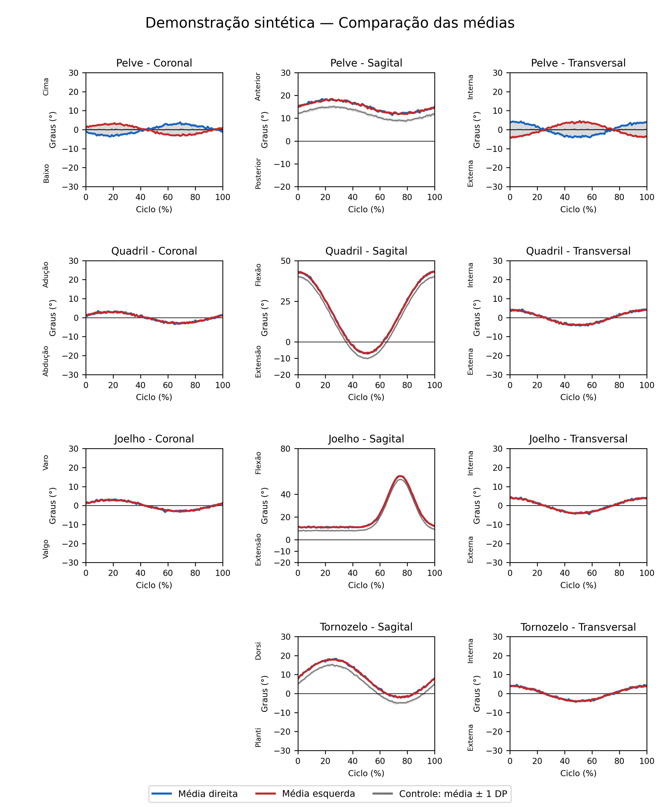

# Gait analysis toolkit

Python tools for reading normalized gait exports, combining trials, reviewing individual cycles and producing right/left kinematic figures with a comparison reference. The repository also retains the supplied MATLAB extraction script for method traceability.



## Run the included example

```bash
git clone https://github.com/cimonetti/gait-analysis-toolkit.git
cd gait-analysis-toolkit
python -m pip install -r requirements.txt
python marcha.py
python -m streamlit run app.py
```

The command-line example uses `config.json` and writes PNG/SVG figures and numerical arrays to `outputs/`. For the interface, upload `examples/synthetic_evaluation_QJT.txt` and its matching PP file, using two right and three left cycles. The included comparison reference is synthetic.

## Features

- Combine cycles from multiple trials without overwriting input files.
- Identify and remove a cycle consistently across the segments of one side.
- Display individual cycles or means; compare right and left means with a reference band.
- Configure axes and optional stance-end markers.
- Export PNG, SVG and cycle arrays.

## Input contract

Tab-separated TXT files with five header lines, 101 normalized rows and finite numerical values. Column 1 contains cycle percentage. QJT blocks contain hip right, hip left, knee right, knee left, foot right and foot left. PP blocks contain pelvis right, pelvis left, foot right and foot left. Each cycle has three consecutive component columns. Component order and signs are specific to the supplied MATLAB routine; consult `mapping.py` before using exports from another model or convention.

No filtering, interpolation, normalization or event detection is performed here. The source exports must already be normalized. Reference means and sample SD are calculated across cycles, with equal weight per cycle, combining sides. They are descriptive cycle statistics; repeated trials are not independent participants. With one cycle, the current display uses a zero-width SD band. The optional legacy pelvic SD mode uses only left cycles while retaining the bilateral mean.

## MATLAB

`matlab/processaMarchaControle.m` is the original workspace-dependent extraction script created by Prof. Felipe Arruda Moura. `matlab/importfile.m` retains the original MATLAB-generated import structure, including its fixed 181-column setting; identifying local paths and variable labels were replaced with generic examples. `matlab/demo.m` supplies filenames and cycle counts for the synthetic example. MATLAB execution has not been verified; Python checks do not establish MATLAB runtime compatibility.

## Credits and tests

The Python application was adapted from Prof. Felipe Arruda Moura's MATLAB script with AI assistance.

Run the tests from `gait-analysis-toolkit/`:

```bash
python -m unittest discover -s tests -v
```

The tests cover column mapping, cycle exclusion, means and sample standard deviations. During portfolio preparation, the command-line example generated figures and arrays, and the Streamlit interface passed an initialization check. File-upload and mouse interactions were not tested.

Public examples use synthetic data and contain no participant recordings or original reference arrays. The demonstration reference has no normative or clinical meaning. For local data, adapt `config.json` and check that column, axis and sign conventions match your exports.
